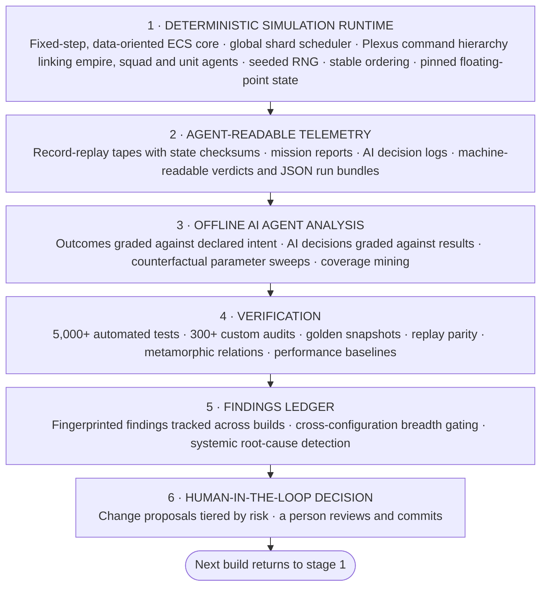
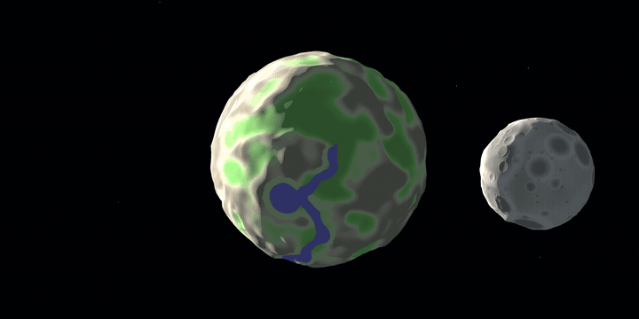
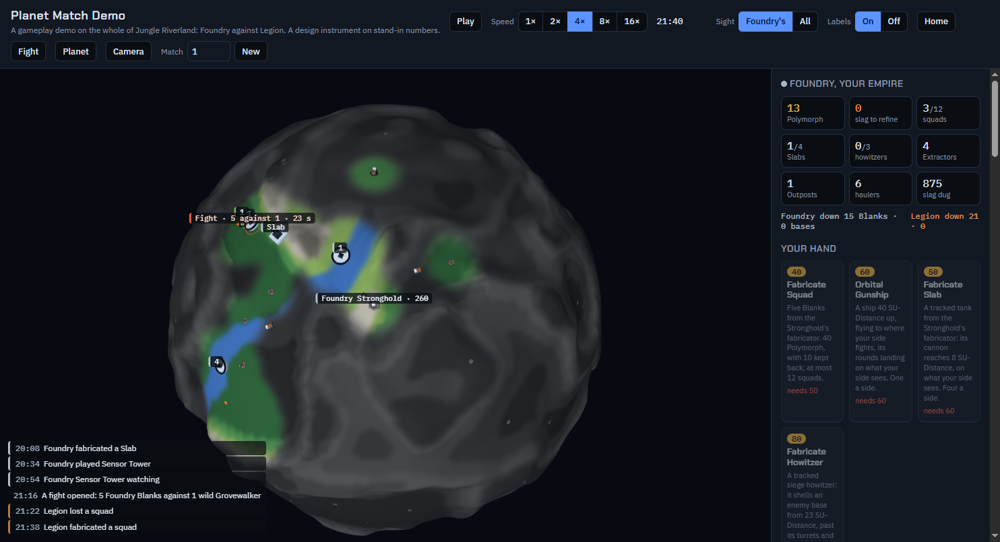
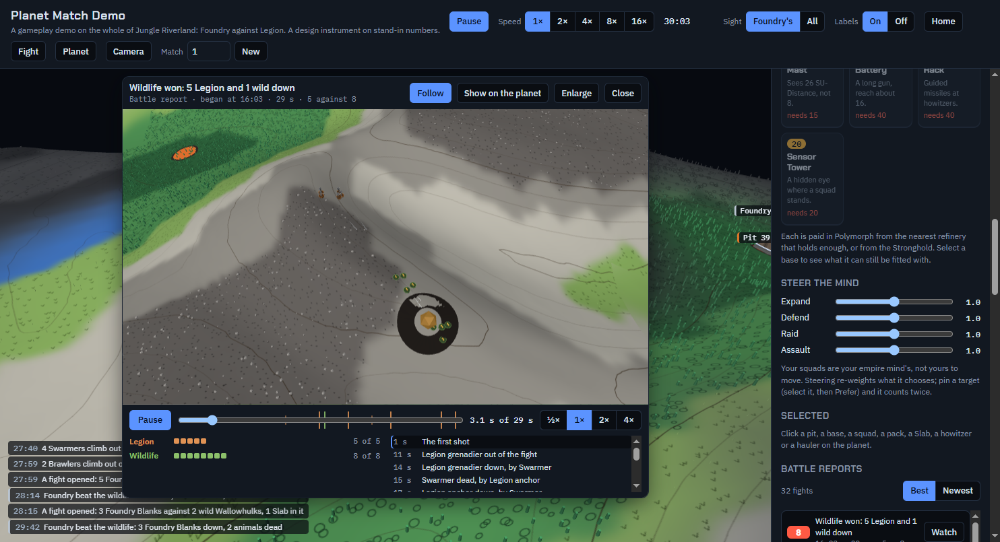
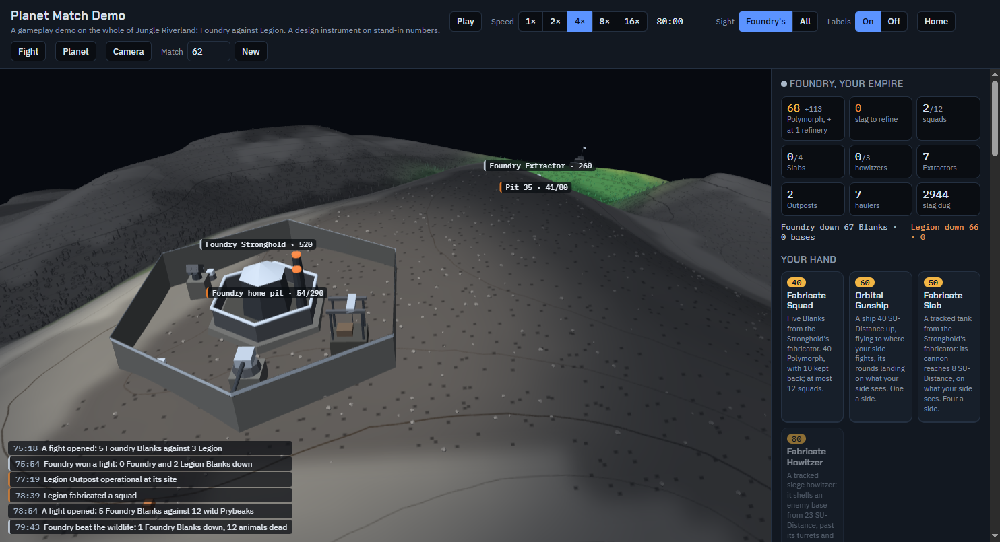
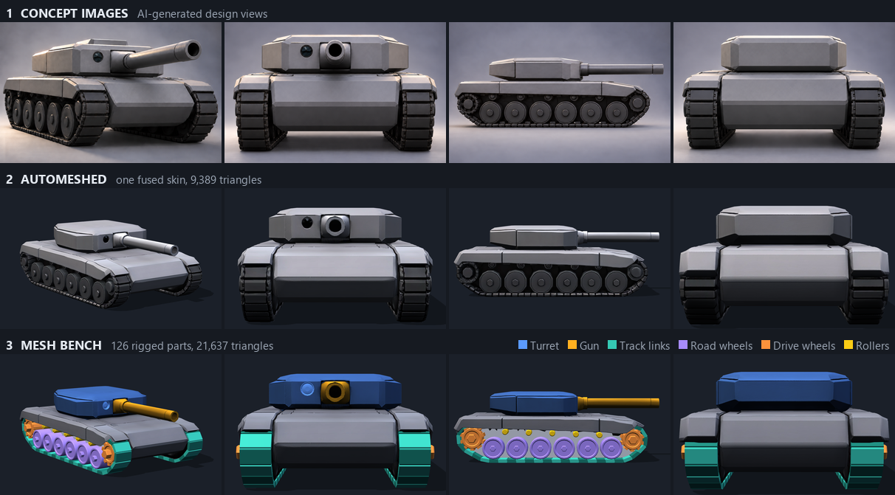
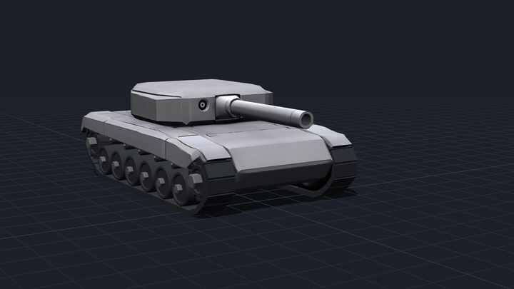

# Deterministic Spatial Multi-Agent Simulation with Self-Reflective Analysis

**A self-diagnosing simulation platform with full-stack observability.** A data-oriented C++ ECS runtime on Unreal Engine, instrumented with agent-readable telemetry and covered by automated tests and custom audits. An offline analysis pipeline grades outcomes against declared intent, attributes missed targets to individual parameters and raises change proposals for human review. Designed to ship as a strategy game.

| 1.5M | 5,000+ | 300+ | 1,400+ | 950+ | 10,600+ |
|:-:|:-:|:-:|:-:|:-:|:-:|
| lines of C++ | automated tests | custom audits | JSON data files | design documents | commits in under 12 months |

*Figures from the private repository, November 2026.*

**Stack:** C++ on Unreal Engine with [EnTT](https://github.com/skypjack/entt), Python for audits and tooling, and a three.js browser prototype.

> **Source preview:** under 2% of a private codebase, published for review. A reading sample, not a buildable project. All rights reserved; see [LICENSE](LICENSE).

## How it works

The loop is designed so that each run informs the next: the system surfaces what is out of order and proposes what to change, and a person decides. Nothing applies itself.

## How it is built

**Human-directed, agent-implemented.** Architecture and design decisions stay with a person, while parallel AI coding agents carry out the implementation on a single shared codebase. Consistency is enforced by the toolchain, not by convention:

- **Automated governance:** 300+ custom audits and a pre-push gate enforce architecture, determinism and data rules.
- **Persistent agent context:** 950+ design documents, served through semantic retrieval and a canonical glossary, give every session one source of truth.
- **Safe concurrency:** scoped commits isolate each session's work on the shared tree.
- **Scope-aware verdicts:** result lines state what was examined, so a check that examined nothing is flagged rather than reported as clean.

## Global shard scheduler

**One orchestrator drives the entire simulation.** Every planet, interstellar squad, space zone and battle is an isolated shard, and the scheduler advances them all on a single fixed-step timeline across worker threads.

- **Phased execution:** each step runs the same pipeline of input, derivation, local simulation, message orchestration, dispatch and snapshots, with barriers around the cross-shard stages.
- **Deterministic messaging:** inter-shard messages carry a due tick and dispatch in a total order, through per-shard timing wheels with far-future staging and dead-letter recovery.
- **Registry-exclusion parallelism:** shards that can write the same ECS registry form one serial group, while separate groups run concurrently.
- **Multi-rate cadences:** tactical, strategic and maintenance work run on a tick ladder derived from one global counter.
- **Graceful overload:** when the simulation can't keep up, it drops into slow motion instead of changing its step size.

## Procedural worlds

**Planets are generated, not modelled.** A seed and a declarative recipe drive the entire body: multifractal height fields, crater populations, hydrology-driven river networks and rule-based terrain classification, baked offline into a seamless six-face cube-sphere, terrain rasters and the simulation's gameplay grid.

*Two bodies from one generator: a river world and a cratered moon, each defined by a seed and a recipe, with no hand-modelled geometry. Rendered from their baked meshes and rasters.*

- **Multi-body runtime:** each body simulates in its own shard under one global scheduler.
- **Scale-invariant size ladder:** bodies are built on icosphere levels. One rung down halves the radius, terrain features rescale automatically and a grid cell keeps its world size, so moons and planets share one ruleset.
- **Content as data:** a new world is a new recipe and seed, not a new art asset.

## As a game

The same runtime can ship as a deckbuilder, 4X, autobattler and roguelike. Players never order units. They build the decks squads and units draw from, chain how each unit behaves, and set their empire's directives, and the units then fight on their own.

*A match on a whole spherical planet. Everything your side can't currently see is under fog.*

A complete match runs in the browser prototype of the core loop:

- One continuous spherical map with no seams, and two empires starting a planet apart
- Resource pits, refineries, and haulers carrying raw material that can be intercepted
- Fights that open where squads meet, pull in squads that arrive, and merge with fights nearby
- Tanks, howitzers, an orbital gunship, wildlife packs, and meteors that hatch monsters
- Fog of war from real line of sight over the terrain
- Scored battle reports you can replay

*Every fight is recorded, scored and can be rewatched.*

*A stronghold behind its walls, with the empire's economy and card hand in the side panel.*

## From image to unit

Units are built by a dedicated asset stack. Image-to-3D automeshing reconstructs concept images as a raw mesh, and the Mesh Bench toolchain takes it from there: immutable, versioned steps cut moving parts free of the skin, procedurally regenerate fused geometry such as tracks and wheels, and rig the result into a kinematic assembly. Every step carries its own geometric checks, and a person reviews the stages side by side.

*Four angles at each stage: the concept images, the raw automeshed skin, and the finished rig with its moving parts coloured.*

*The Slab tank on its rig: the turret traverses, the gun elevates, and 92 track links and 26 wheels run as separate parts.*

## Read the code

| Stage | Start with | Why it's interesting |
|---|---|---|
| 1 Runtime | [`StepOneFixedTick`](scheduler/GlobalShardSchedulerTick.cpp#L190) | One fixed step of the entire simulation, in a single function. Every planet, squad and battle simulates in isolation across worker threads. |
| 1 Runtime | [`IsMessageHigherDispatchPriority`](scheduler/GlobalShardSchedulerMessageRouting.cpp#L30) | Shards exchange data only through messages applied at a stated tick. Priority, due tick, emit tick and a sequential id give every message a strict dispatch order, so no two can tie. |
| 1 Runtime | [`GetRegistryOwnerShardId`](scheduler/ShardBridgeInterface.h#L113) | The parallelism contract. Each shard declares which ECS registry it writes. Shards that share one run serially as a group and separate groups run concurrently, so a registry is never touched by two threads at once. |
| 1 Runtime | [`determinism/DeterministicIteration.h`](determinism/DeterministicIteration.h) | Hash-map order depends on insertion history, so two identical game states can walk a map differently. Here the safe walk is the easy one: raw pointer keys are rejected at compile time, and `FName` keys are routed to the only comparator that is stable between runs. |
| 1 Runtime | [`determinism/DeterministicDestruction.h`](determinism/DeterministicDestruction.h) | The order a batch of entities is destroyed in decides which ids the next entities receive. Batches go through one helper that sorts them by save-persistent id, so the sequence holds across a save and load. |
| 1 Agents | [`agents/SquadAuctionRun.cpp`](agents/SquadAuctionRun.cpp) | Squads bid for open objectives, highest priority first. Ties go to the lowest squad ID, so the result never depends on iteration order. |
| 1 Spatial | [`FindPathInternal`](spatial/IcogridPathfinding.cpp#L112) | One query layer over a planet's icosphere grid: A* with great-circle and slope costs, line of sight and baked horizon profiles. |
| 2 Telemetry | [`replay/DeterminismTapeFormat.h`](replay/DeterminismTapeFormat.h) | Only outside inputs are recorded. Everything else has to reproduce itself, and periodic checksums show where a run diverged. |
| 2 Telemetry | [`analysis/verdict.py`](analysis/verdict.py) | Every tool's result states what it examined. A check that looked at nothing gets its own status and exit code, so it can't read as a pass. |
| 3 Analysis | [`analysis/reflect_match.py`](analysis/reflect_match.py) | Grades a battle report against the outcome its scenario declares. A metric the report can't answer is flagged as a coverage gap, never counted as a pass. |
| 3 Analysis | [`analysis/reflect_counterfactual.py`](analysis/reflect_counterfactual.py) | Re-runs a scenario with one parameter changed at a time and names which change brings a missed target back over its threshold. |
| 4 Verification | [`replay/tests/RealShardTapeParityTests.cpp`](replay/tests/RealShardTapeParityTests.cpp) | Records a planet shard with real combatants through the production scheduler, replays it into a fresh world and requires bit-identical checkpoints. |
| 4 Verification | [`audits/tiebreak_determinism_audit.py`](audits/tiebreak_determinism_audit.py) | Static analysis for a hidden source of desync: a best-pick over unordered data with no tie-break, or an unstable sort on a single key. |
| 5 Ledger | [`analysis/reflect_ledger.py`](analysis/reflect_ledger.py) | Tracks each finding across builds. It closes only when a run actually re-checked it, and is marked reopened if it comes back. |
| 6 Decision | [`analysis/reflect_propose.py`](analysis/reflect_propose.py) | Clusters open findings into proposals tiered by risk. It has no write path into game data, so a person applies every change. |

## Project status

**Pre-release and in active development.** The core systems are in place and being refined.

- **Determinism** makes reflective analysis of the simulation's data structures trivially stable: the same build given the same inputs is designed to reproduce the same state, so a difference between two runs points to a real change rather than noise. Each new test, audit and measurement gets a fixed baseline to build on, which is what lets the project's logic chains keep growing. The guarantee is per build and isn't claimed across versions or platforms.
- **Prototyping:** new features are demo-tested as interactive Claude Code artifacts, self-contained pages that run in a browser, so trying an idea doesn't require a full Unreal package. Some features therefore exist there before they reach the Unreal build. Balance values in these demos are placeholders, and two factions are fully playable so far.

## Not in this repository

The rest of the scheduler, analysis tooling and audits, along with the planet generator, empire AI, combat, economy, cards, units, game data and art, remain private.

© 2026 Louis Bühler. All rights reserved: no permission is granted to use, modify or redistribute this code, beyond what GitHub's terms require.
